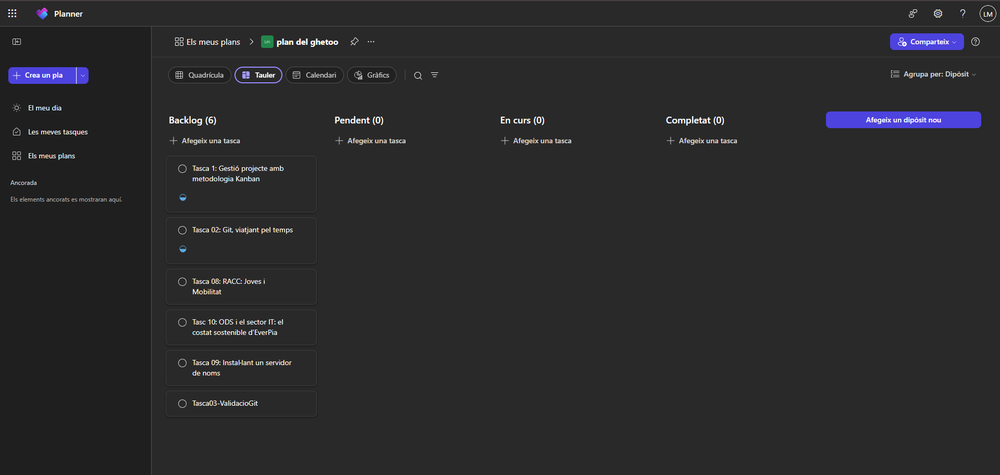
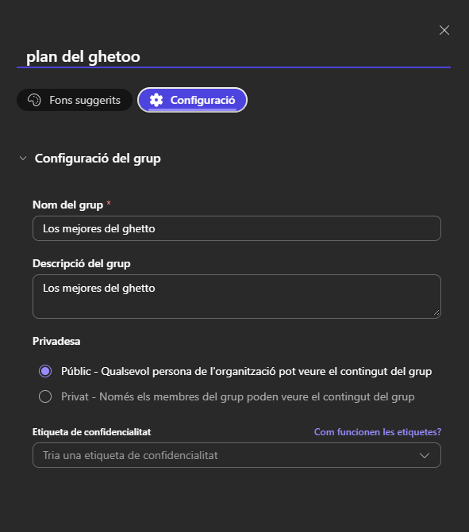
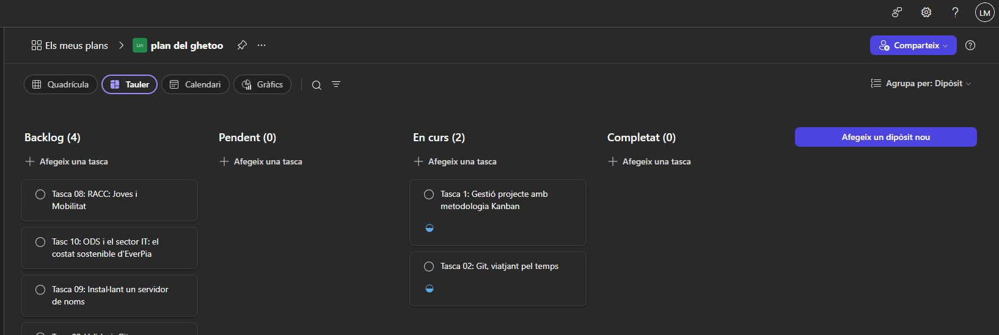

# Creació del pla kanban.

Hem creat el següent plan bàsic amb les tasques d'aquest projecte al backlog:

Com compartirem el nostre link haurem de posar el kanban en format public:

Primera setmana de simulació:

[Link Kanban](https://planner.cloud.microsoft/ui/web/v1/plan/uGGG55ro_0OM5-DV2U8YfJYAHPkE?tid=c7b5981a-7820-4ac8-ae65-03515ea81317)
