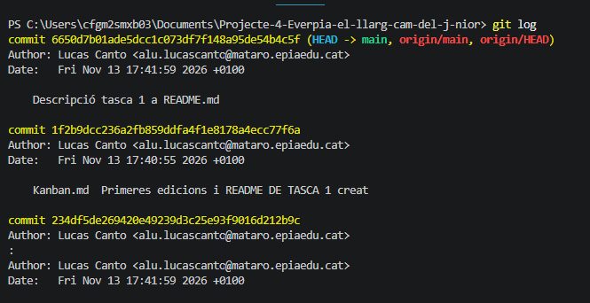
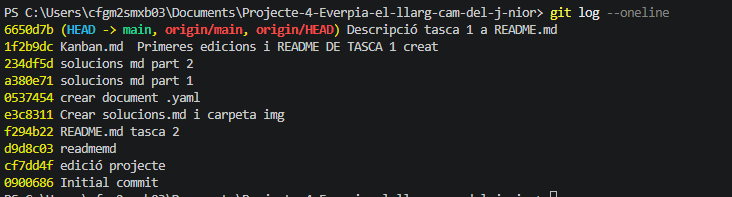
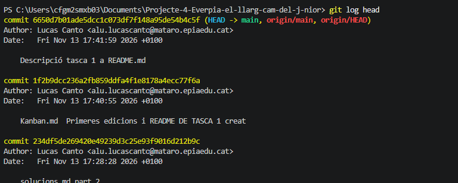

# Part 1: Bones pràctiques en la documentació de commits

__Crea un fitxer anomenat README.md a dins el repositori amb una breu descripció de la funcionalitat del repositori.__

# Part 2: L'historial del repositori
Com a profesional, sovint hauràs de revisar l'historial del repositori per saber qui va fer un canvi determinat o quin dia es va modificar una configuració concreta.

Observa l'historial del teu repositori amb l'historial detallat, identificant la informació disponible per cada commit, executant a la terminal la comanda:
git log

Compara el resultat amb l'historial resumit, executant a la terminal la comanda:
git log --oneline

Usa l'eina gràfica de l'editor VS Code per veure l'historial del repositori i comparar-lo amb el que has vist a la terminal.

Inspecciona els canvis exactes del darrer commit amb la comanda:

git show HEAD
Observa també la mateixa informació amb l'eina gràfica de l'editor VS Code, seleccionant el darrer commit.

# Part 3: Recuperar versions anteriors del working directory

Imagina que estàs editant el fitxer 00-installer-config.yaml i, per error, esborres informació crucial o comets una erada de tecleig. Com que encara no has fet git commit, pots descartar els canvis del Working Directory i tornar el fitxer a l'estat del darrer commit.

Simularem un error humà editant el fitxer 00-installer-config.yaml:

