# LVM amb Zorin OS

Comprovem amb __lsblk__ que el sistema detecta els nous discos durs de 10 GB abans de configurar-los.


Inicialitzem els discos com a Volums Físics (PV) i creem el Grup de Volums (VG) anomenat vg_dades.

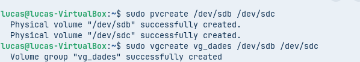

Dins del grup vg_dades, s'ha creat un volum lògic anomenat lv_inicial amb una capacitat d'1 GB.

Aquest volum permet disposar d'una unitat d'emmagatzematge independent que es pot formatar, muntar i ampliar posteriorment.

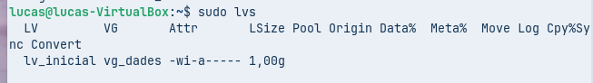

S'ha formatat el volum lv_inicial amb el sistema de fitxers EXT4 mitjançant l'ordre mkfs.ext4.

Aquesta operació prepara el volum perquè pugui emmagatzemar fitxers i directoris.

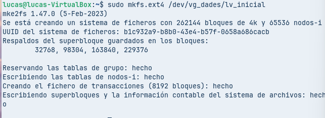

S'ha creat el directori /mnt/lv_inicial, que s'utilitza com a punt de muntatge del volum lògic.

Després s'ha muntat el volum en aquest directori mitjançant l'ordre mount. Finalment, s'ha comprovat que estava muntat correctament amb l'ordre df -h.

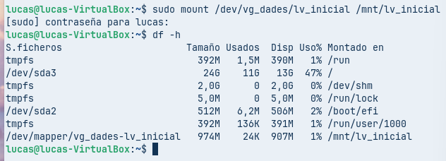

Per evitar haver de muntar manualment el volum cada vegada que s'inicia el sistema, s'ha modificat el fitxer /etc/fstab.

S'hi ha afegit la següent línia:

```
/dev/vg_dades/lv_inicial /mnt/lv_inicial ext4 defaults 0 2
```
Aquesta configuració indica al sistema que ha de muntar automàticament el volum lv_inicial al directori /mnt/lv_inicial durant l'arrencada.

Per comprovar que la configuració funcionava, s'ha executat sudo mount -av i posteriorment df -h.

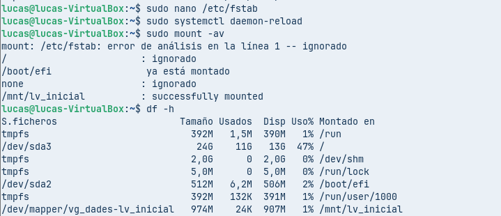

# 2. Alta disponibilitat: LVM Mirror

Creació del volum en mirall
S'ha creat un volum lògic anomenat lv_mirror amb una capacitat d'1 GB i l'opció -m1.

Aquesta configuració crea un volum en mirall que manté dues còpies de les dades en discos físics diferents. D'aquesta manera, si un dels discos falla, es pot continuar disposant de la informació emmagatzemada a l'altre disc.

S'ha utilitzat la següent ordre:

```
sudo lvcreate -L 1G -m1 -n lv_mirror vg_dades
```
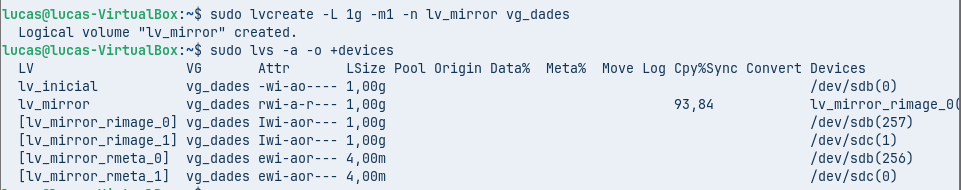

# 3. Instantànies (Snapshots)

Afegir dos discos nous
S'han afegit dos discos virtuals nous de 10 GB cadascun a la màquina virtual mitjançant VirtualBox.

Un cop iniciat Zorin OS, s'han identificat els nous discos amb l'ordre lsblk.

Els discos nous són:
/dev/sdd: destinat a emmagatzemar les dades.
/dev/sde: destinat a emmagatzemar la instantània.

Ampliació del grup de volums
S'ha inicialitzat el disc /dev/sdd com a volum físic de LVM mitjançant pvcreate.

A continuació, s'ha afegit al grup de volums vg_dades amb l'ordre vgextend.

Això permet augmentar l'espai disponible dins del grup de volums i utilitzar-lo per crear nous volums lògics.

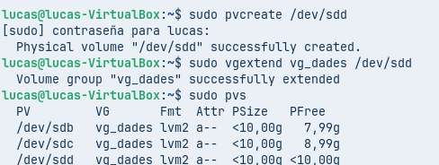

Creació del volum de dades
S'ha creat un volum lògic anomenat lv_dades amb una capacitat de 5 GB dins del grup vg_dades.

Aquest volum s'utilitzarà per emmagatzemar els fitxers de prova que posteriorment es protegiran mitjançant una instantània.

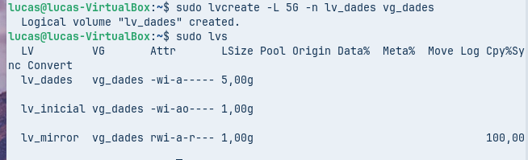

Formatació del volum de dades
S'ha formatat el volum lv_dades amb el sistema de fitxers EXT4.

D'aquesta manera, el volum queda preparat per poder emmagatzemar-hi informació.

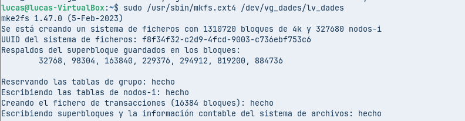

Muntatge del volum de dades
S'ha creat el directori /mnt/lv_dades i s'hi ha muntat el volum lògic.

Finalment, s'ha utilitzat l'ordre df -h per comprovar que el volum estava muntat correctament i que disposava de l'espai esperat.

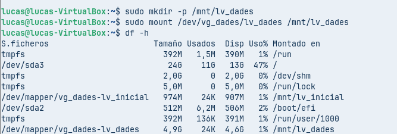

Per demostrar el funcionament de les instantànies, s'han creat diversos fitxers de prova dins del directori /mnt/lv_dades/fitxers.

S'hi han afegit tres documents de text amb l'objectiu de tenir informació que posteriorment es pugui modificar i recuperar.

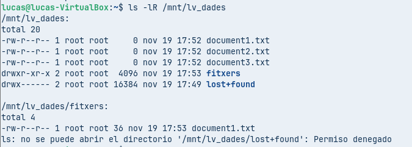

S'ha inicialitzat el disc /dev/sde com a volum físic mitjançant pvcreate.

Després, s'ha incorporat al grup vg_dades amb l'ordre vgextend.

Aquest disc s'utilitzarà per reservar espai a la instantània del volum de dades.

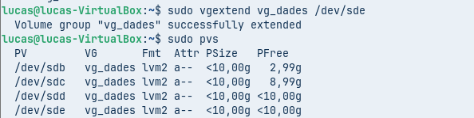

S'ha creat una instantània anomenada lv_snapshot amb una capacitat de 2 GB, associada al volum original lv_dades.

Per fer-ho, s'ha utilitzat l'opció -s de l'ordre lvcreate.

La instantània conserva l'estat del volum original en el moment de la seva creació i permet recuperar les dades si posteriorment es modifiquen o es fan malbé.

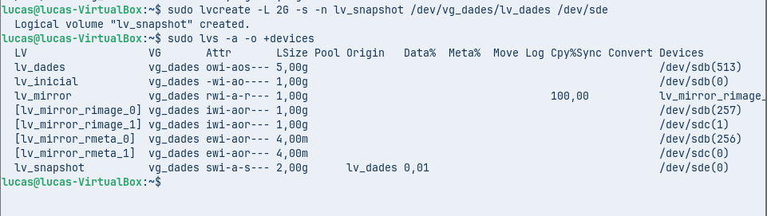

Per demostrar la utilitat de la instantània, s'ha modificat el contingut del fitxer document1.txt, substituint la informació original per un text que simula dades danyades.

Això permet comprovar si és possible recuperar la informació anterior mitjançant la instantània creada.

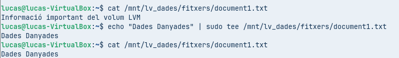

Per recuperar la informació original, primer s'ha desmuntat el volum lv_dades.

Després, s'ha executat l'ordre lvconvert --merge per fusionar la instantània amb el volum original.

Aquesta operació restaura el volum a l'estat que tenia quan es va crear la instantània. Posteriorment, s'ha tornat a muntar el volum i s'ha comprovat que el contingut original de document1.txt s'havia recuperat correctament.

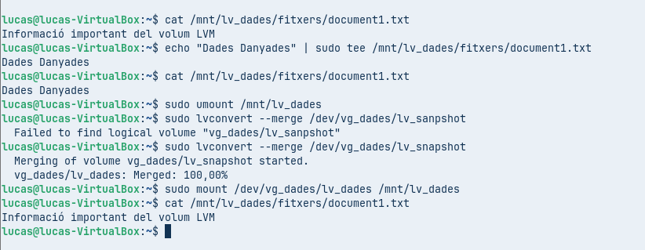


__La meva conclusió:__

Durant aquesta pràctica he treballat amb LVM a Zorin OS: vaig crear volums físics, un grup de volums i volums lògics, i els vaig muntar automàticament amb /etc/fstab. També vaig configurar un volum en mirall per tenir redundància, vaig recuperar dades amb instantànies després de simular una corrupció i vaig ampliar volums lògics. Així he entès millor la utilitat de LVM en l’administració de sistemes Linux.