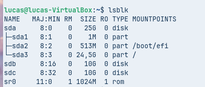

# LVM amb Zorin OS

Comprovem amb __lsblk__ que el sistema detecta els nous discos durs de 10 GB abans de configurar-los.

Inicialitzem els discos com a Volums Físics (PV) i creem el Grup de Volums (VG) anomenat vg_dades.

Creem un Volum Lògic en mode mirall (RAID 1) per protegir les dades, el formatem en ext4 i afegim la ruta a l'arxiu /etc/fstab per fer el seu muntatge automàtic en iniciar el sistema.

