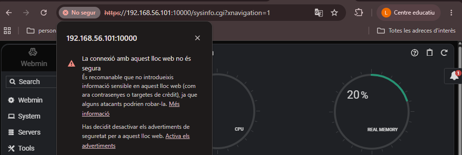
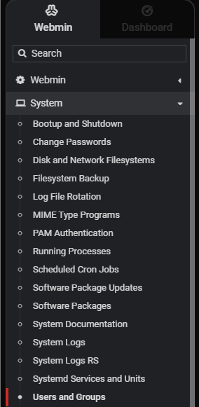
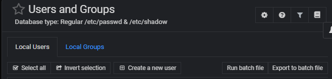
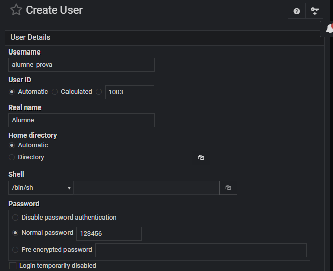
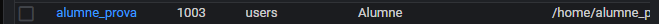
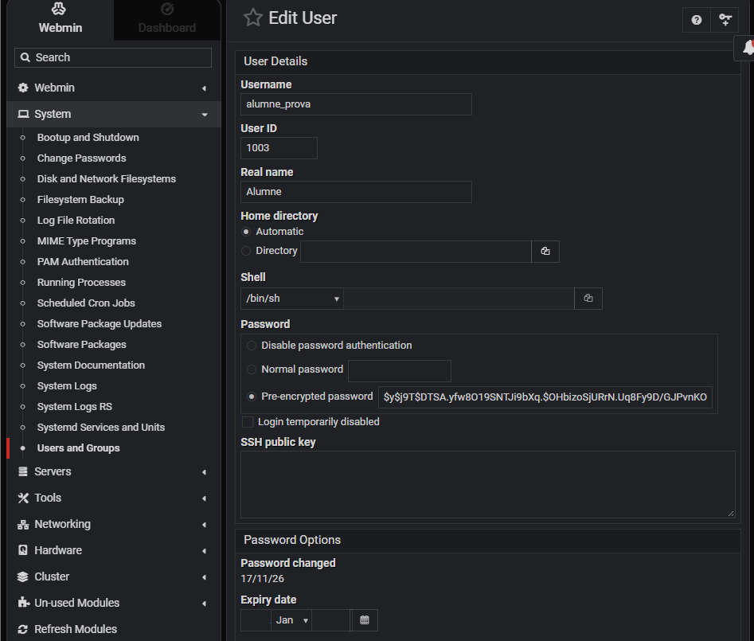
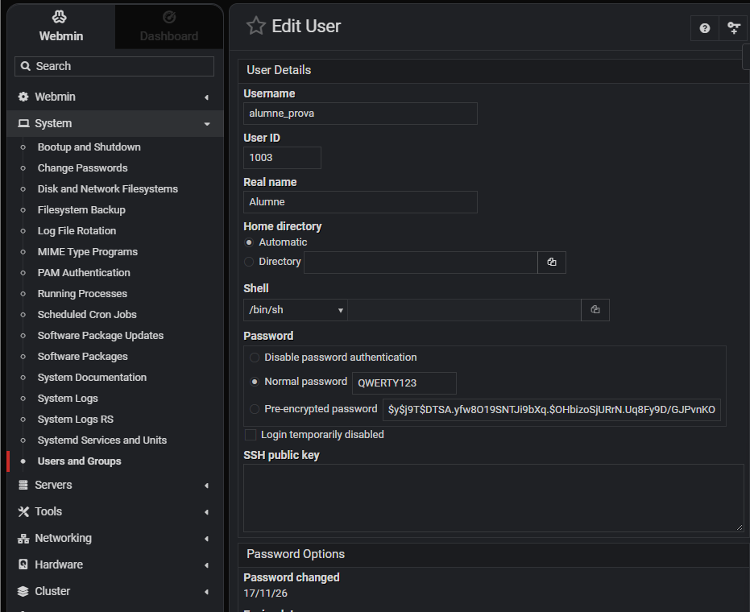

# Fase 1: individual
Cada alumne treballa amb el seu servidor Linux (Ubuntu Server). Cada alumne tria un dels gestors gràfics disponibles. Els gestors gràfics mínims a instal·lar i configurar són:

Cockpit
Webmin

En el nostre cas utilitzarem __Webmin__ 

# PAS 1 Instal·lar el gestor assignat mitjançant repositoris o l'script oficial.

# PAS 2 Accés a la interfície web.

Accedim dintre possant: https://<IP_DEL_TEU_SERVIDOR>:10000

I et sortirà un menú de INICI de SESSIÓ i hauràs de posar les credencials d'un usuari que tingui privilegis sudo.

# PAS 3 Incidències trobades i com s'han resolt.

__Incidència 1:__ Avís de seguretat al navegador (Certificat invàlid).

En intentar accedir a la URL, Chrome/Firefox bloquejava la pàgina amb el missatge "La connexió no és privada".

(Surt això perquè no he fet la captura abans.)

Això passa perquè Webmin utilitza un certificat SSL auto-signat (self-signed) per defecte. S'ha resolt fent clic a "Avançat" i seleccionant "Continuar a [IP] (insegur)".

# PAS 4 Funcionament de l'eina i funcionalitats disponibles
Webmin és una interfície basada en web per a l'administració de sistemes per a Unix/Linux. Permet gestionar pràcticament tots els aspectes del servidor des d'un entorn gràfic en lloc d'haver d'editar fitxers de text i executar comandes manualment al terminal.

Funcionalitats principals:

Gestió de paquets i actualitzacions del sistema.

Monitoratge de l'estat del sistema (CPU, RAM, espai en disc).

Configuració de xarxes, tallafocs (UFW/iptables) i rutes.

Gestió d'usuaris i grups del sistema.

Administració de serveis.

# PAS 5 Prova de funcionalitats rellevants.

__Crear un usuari nou:__
S'ha procedit a crear un usuari nou de prova al sistema des de la interfície web.

Al menú lateral cliquem a Systems i entrem a Users and Groups.

Hem de fer clic a create a new user

Posarem el username, nom real i la contrasenya en format Normal Password.

I ara creem l'usuari i surt a la nostra llista.

__Canviar la contrasenya d'un usuari existent__
Des de la mateixa secció de "Users and Groups":

A la llista d'usuaris, s'ha fet clic sobre el nom de l'usuari creat anteriorment (alumne_prova).

A l'apartat Password, s'ha seleccionat "Normal password" i s'ha escrit la nova contrasenya.

Hem canviat de __123456__ a __QWERTY123__.

S'ha fet clic a Save. El sistema ha aplicat el canvi automàticament sense necessitat d'utilitzar la comanda passwd per consola.

# FASE 2

[Repo del meu company](https://github.com/noahrodrii/Projecte-4/blob/main/Tasca06/fitxa_tecnica.md)

[Presentació](https://notebooklm.link.google/dHcHy2wIpm3Q)
