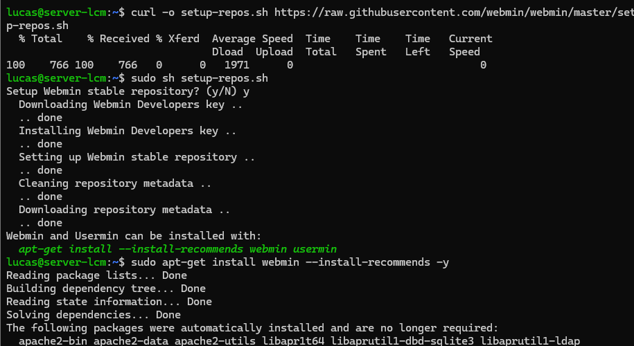
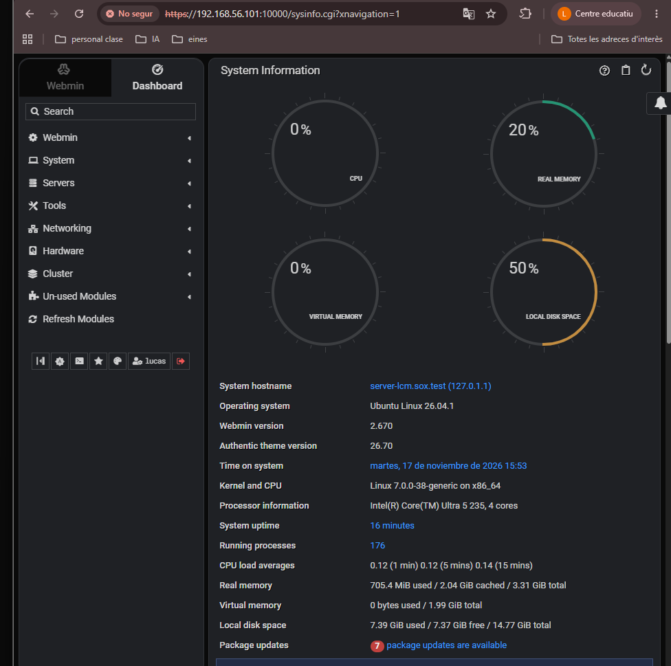

# Fase 1: individual
Cada alumne treballa amb el seu servidor Linux (Ubuntu Server). Cada alumne tria un dels gestors gràfics disponibles. Els gestors gràfics mínims a instal·lar i configurar són:

Cockpit
Webmin

En el nostre cas utilitzarem __Webmin__ 

# PAS 1

__Instal·lar el gestor assignat mitjançant repositoris o l'script oficial.__

# PAS 2 

__Accés a la interfície web.__

Accedim dintre possant: https://<IP_DEL_TEU_SERVIDOR>:10000

I et sortirà un menú de INICI de SESSIÓ i hauràs de posar les credencials d'un usuari que tingui privilegis sudo.

# PAS 3

